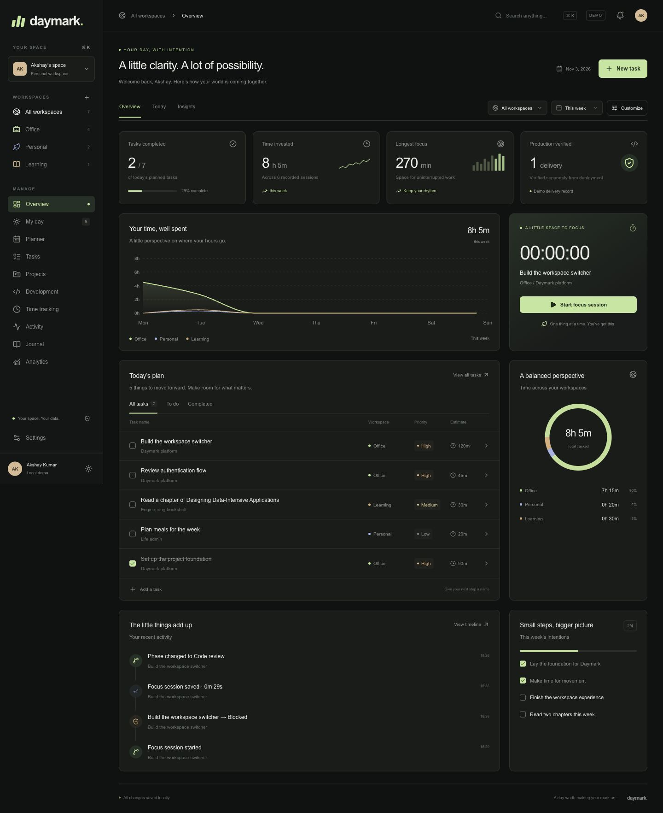

# Daymark

An open-source, privacy-first personal work and life intelligence dashboard. Daymark records what you planned, what you worked on, how much time you invested and what you actually delivered, across private Office, Personal, Learning and custom workspaces.



Status: **0.2.0, pre-release.** The code is complete for a public beta and tested locally; no hosted deployment exists yet. See [docs/DEVELOPMENT_PLAN.md](docs/DEVELOPMENT_PLAN.md) for exactly what is implemented, verified and planned.

## What it does

- **Workspaces** with their own projects, configurable statuses (behaviour set by flags, not names), task types, phases and tags.
- **Tasks** with subtasks, dependencies, priorities, estimates, planned and due dates, tags, search, filters and archive.
- **History you can trust:** every status, phase and planning change is recorded in a transaction; moving a task never erases its original plan.
- **Planning:** daily view with carryover, weekly planner with drag and drop, weekly goals, daily notes and end-of-day reviews.
- **Time tracking:** a server-side timer with pause and resume that survives refreshes and devices (one active timer per account, enforced by the database), plus audited manual entries with overlap detection.
- **Development tracking:** repositories, branches, Jira/PR/commit/docs references, and separate merge, deployment and production-verification records per environment.
- **Activity timeline, journal (Markdown) and analytics:** completion, time distribution, estimate versus actual, carryover, cycle time, delivery rates. No combined "productivity score".
- **Your data:** JSON export and restore, CSV exports, account deletion. No tracking scripts.

## Local development

Requirements: Node.js 20.9+, pnpm 10 (`corepack enable`), Docker.

```bash
git clone https://github.com/akshayxemo/daymark.git
cd daymark
corepack enable
pnpm install
cp .env.example .env.local        # set BETTER_AUTH_SECRET (openssl rand -base64 32)
docker compose up -d db           # PostgreSQL on 127.0.0.1:5432, plus a daymark_test database
pnpm db:migrate
pnpm db:seed --demo               # optional: fictional demo account demo@daymark.local
pnpm dev                          # http://localhost:3000
```

With the default `EMAIL_PROVIDER=console`, verification and reset links are printed in the terminal running `pnpm dev`. To receive real SMTP mail locally, run `docker compose --profile mail up -d mailpit` and use its inbox at `http://127.0.0.1:8025`.

## Scripts

| Command                                                                  | Purpose                                                                       |
| ------------------------------------------------------------------------ | ----------------------------------------------------------------------------- |
| `pnpm dev` / `pnpm build` / `pnpm start`                                 | Develop, build, run the production server                                     |
| `pnpm typecheck` / `pnpm lint` / `pnpm format`                           | Type checking, ESLint, Prettier                                               |
| `pnpm test`                                                              | Unit tests                                                                    |
| `pnpm test:integration`                                                  | Tests against PostgreSQL (`TEST_DATABASE_URL`, wiped on each run)             |
| `pnpm test:e2e`                                                          | Playwright against the production build; needs PostgreSQL and Mailpit running |
| `pnpm db:migrate` / `db:status` / `db:seed` / `db:reset` / `db:generate` | Database lifecycle, see [docs/DATABASE.md](docs/DATABASE.md)                  |

## Deploying

- Vercel + Supabase: [docs/SUPABASE_SETUP.md](docs/SUPABASE_SETUP.md), then [docs/VERCEL_DEPLOYMENT.md](docs/VERCEL_DEPLOYMENT.md).
- Self-hosted with Docker Compose: [docs/DEPLOYMENT.md](docs/DEPLOYMENT.md#self-hosting-with-docker-compose).
- Every environment variable: [docs/DEPLOYMENT.md](docs/DEPLOYMENT.md#environment-variables).

## Documentation

[Architecture](docs/ARCHITECTURE.md) · [Database](docs/DATABASE.md) · [Security review](docs/SECURITY.md) · [Product specification](docs/PRODUCT_SPEC.md) · [Decision records](docs/adr/) · [Contributing](CONTRIBUTING.md) · [Security policy](SECURITY.md) · [Changelog](CHANGELOG.md)

## Moving from the browser-only preview

Version 0.1.0 stored a demo in your browser (`localStorage` key `daymark.design.v1`). After signing in, **Settings → Your data** detects it, shows what it contains and imports it on request. The built-in fictional sample tasks are skipped unless you include them, and the browser copy is kept until you remove it.

## License

[MIT](LICENSE). Do not record patient data, credentials or confidential employer information in a hosted instance you do not control.
